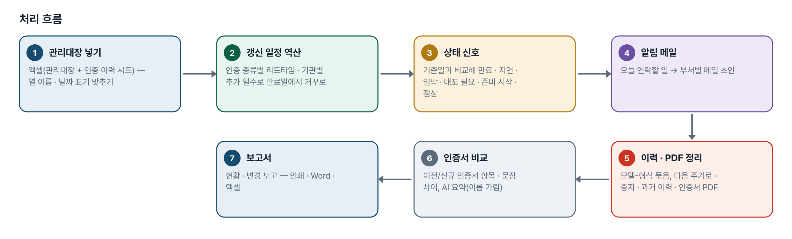
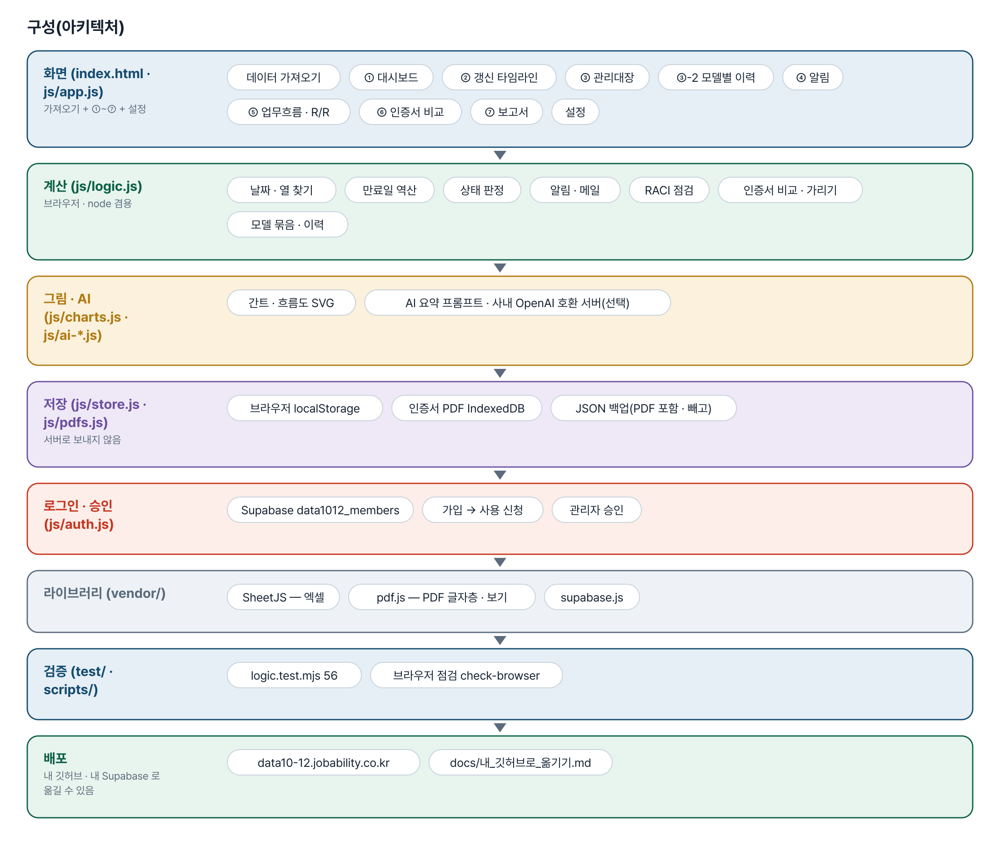
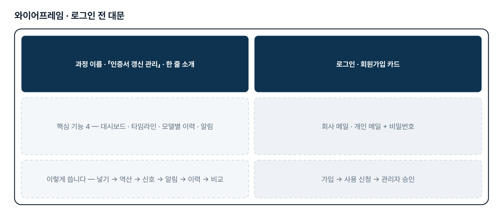
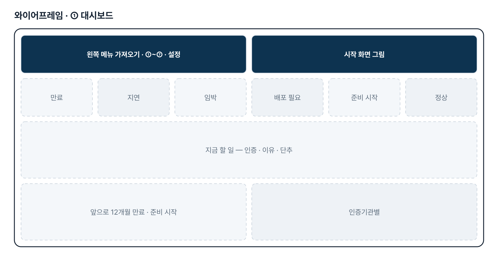
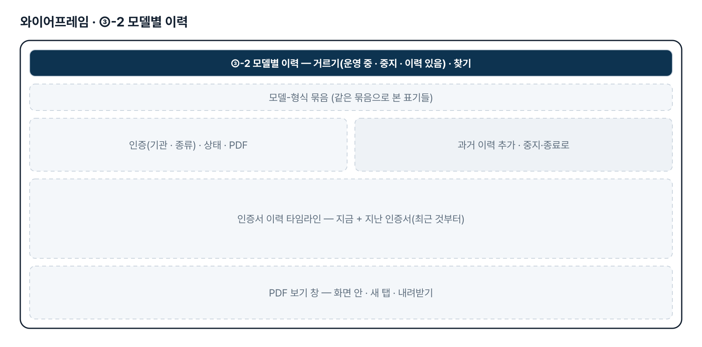

# 인증서 갱신 관리 — 프로젝트 기획서 v2.0

- 기획: 윤한산 · 작성일 2026-11-10 · 현장 데이터 디지털화 전문가과정 · 2차수 프로젝트 12
- 바로 쓰기: https://data10-12.jobability.co.kr/
- 워드 판: `docs/기획서/data10-12_윤한산_인증서갱신관리_기획서_v2.0.docx`

## 개요

인증 관리대장 엑셀을 넣으면 만료일에서 거꾸로 갱신 일정을 세워 상태 신호와 간트로 보여 주고, 부서별 알림 메일 초안 · 모델-형식별 인증 이력과 인증서 PDF · 신구 인증서 비교 보고서를 만드는 도구입니다.

### 배경 · 현재 업무
- 품질부서는 각종 Certification, 특히 선급 Type Approval(형식승인)을 관리하며 인증마다 유효기간이 있어 만료 전에 갱신해야 합니다.
- 갱신은 준비 → 인증기관 신청 → 기관 심사 → 피드백 대응 → 발급으로 이어지고, 기관 피드백 때문에 전체 기간(Lead-Time)이 길고 들쭉날쭉합니다.
- 갱신 주기 점검 · 사전 준비와 새 인증서를 영업 · 품질 · 개발 관련인에게 배포 · 공유하는 일을 제때 하지 못하고 있습니다.
- 자료가 인증서 문서 · 별도 관리대장 엑셀 · 담당자 e-Mail 에 흩어져 있습니다.

### 목표
- 관리대장을 한곳에 모아 인증마다 만료일에서 거꾸로 센 갱신 일정을 같은 기준으로 봅니다.
- 늦어지는 인증을 상태 신호(만료 · 지연 · 임박 · 배포 필요 · 준비 시작 · 준비 예정 · 정상)로 먼저 알아챕니다.
- 할 일이 생기면 영업 · 품질 · 개발 관련인에게 보낼 알림 메일 초안을 만듭니다.
- 새 인증서를 받으면 이전 인증서와 바뀐 점을 요약해 보고합니다.
- 같은 모델-형식의 지금 · 지난 · 중지된 인증과 인증서 PDF 를 한 묶음으로 봅니다.

## 요구사항과 구현

| 기획서 요구 | 구현 |
|---|---|
| 업무흐름도(관련부서 R/R 포함) | 단계표(RACI)를 고치면 부서별 줄 흐름도가 다시 그려짐, SVG 내려받기 · RACI 규칙 점검 |
| 실시간 관리대장 비주얼화(준비 · 기관 피드백 감안 Lead-Time) | 인증 종류별 리드타임 · 기관별 추가 일수로 만료일 역산 → 대시보드 상태 신호 · 갱신 타임라인(간트) |
| 영업 · 품질 · 개발 Alert | 오늘 연락할 사람(인증마다 가장 최근의 끝나지 않은 일) · 부서별 메일 초안(메일 앱 · 복사). 자동 발송은 2단계 |
| 이전/신규 인증서 변경 요약 · 보고서 | PDF 글자층 · 붙여 넣기 → 항목 · 문장 · 낱말 비교, AI 요약 프롬프트(회사명 · 메일 · 전화 · 번호 가림), 보고서 인쇄 · Word · 엑셀 |
| 운영 중 인증의 과거 이력(10-27) | ③-2 「과거 이력 추가」 · 엑셀 「인증 이력」 시트 · 다음 주기로 넘기기 |
| 중지된 인증의 이력(10-27) | 운영 상태 중지 · 만료 종료 · 폐기 + 사유 · 중지일 — 알림 · 건수에서 빠지고 이력에 남음 |
| 인증서 PDF 올려 보기(10-27) | 인증 · 이력 줄마다 PDF 한 장(IndexedDB, 15MB) — 화면 안 보기 · 새 탭 · 바꾸기 · 빼기 |
| 「모델-형식」 Key 로 그룹핑(10-27) | 띄어쓰기 · 대소문자 · 하이픈 모양을 무시한 묶음 키, ③-2 모델별 이력 화면 |
| 담당자 e-Mail 활용 | 2단계 — 메일에서 신청 · 피드백 날짜 뽑기 |

## 주요 기능

- **상태 신호 대시보드** — 만료 · 지연 · 임박 · 배포 필요 · 준비 시작 · 정상 건수와 지금 할 일, 앞으로 12개월 만료를 한 화면에 봅니다.
- **갱신 타임라인** — 만료일에서 거꾸로 준비 → 기관 심사 → 피드백 → 발급 일정을 세워 인증별 간트로 그립니다.
- **모델별 이력 · PDF** — 모델-형식으로 묶어 지금 · 지난 · 중지된 인증서와 인증서 PDF 를 함께 봅니다.
- **알림 메일 초안** — 오늘 연락할 사람을 골라 영업 · 품질 · 개발 부서별 메일 초안을 만듭니다.
- **관리대장 가져오기** — 엑셀 여러 개, 다른 열 이름 · 날짜 표기도 읽고 같은 인증은 한 줄로 합칩니다.
- **업무흐름 · R/R** — 단계표(RACI)로 부서별 줄 흐름도를 그리고 규칙을 점검합니다.
- **인증서 비교 · 보고서** — 이전/신규 인증서의 항목 · 문장 차이와 AI 요약(이름 가림), 현황 · 변경 보고서를 냅니다.
- **로그인 · 승인** — 회사 메일 또는 개인 메일로 가입하고 사용 신청 → 관리자 승인 뒤에 씁니다.

## 처리 흐름(파이프라인)

1. **관리대장 넣기** — 엑셀(관리대장 + 인증 이력 시트) — 열 이름 · 날짜 표기 맞추기
2. **갱신 일정 역산** — 인증 종류별 리드타임 · 기관별 추가 일수로 만료일에서 거꾸로
3. **상태 신호** — 기준일과 비교해 만료 · 지연 · 임박 · 배포 필요 · 준비 시작 · 정상
4. **알림 메일** — 오늘 연락할 일 → 부서별 메일 초안
5. **이력 · PDF 정리** — 모델-형식 묶음, 다음 주기로 · 중지 · 과거 이력 · 인증서 PDF
6. **인증서 비교** — 이전/신규 인증서 항목 · 문장 차이, AI 요약(이름 가림)
7. **보고서** — 현황 · 변경 보고 — 인쇄 · Word · 엑셀

## 구성(아키텍처)

- **화면 (index.html · js/app.js)** — 데이터 가져오기 · ① 대시보드 · ② 갱신 타임라인 · ③ 관리대장 · ③-2 모델별 이력 · ④ 알림 · ⑤ 업무흐름 · R/R · ⑥ 인증서 비교 · ⑦ 보고서 · 설정
- **계산 (js/logic.js)** — 날짜 · 열 찾기 · 만료일 역산 · 상태 판정 · 알림 · 메일 · RACI 점검 · 인증서 비교 · 가리기 · 모델 묶음 · 이력
- **그림 · AI (js/charts.js · js/ai-*.js)** — 간트 · 흐름도 SVG · AI 요약 프롬프트 · 사내 OpenAI 호환 서버(선택)
- **저장 (js/store.js · js/pdfs.js)** — 브라우저 localStorage · 인증서 PDF IndexedDB · JSON 백업(PDF 포함 · 빼고)
- **로그인 · 승인 (js/auth.js)** — Supabase data1012_members · 가입 → 사용 신청 · 관리자 승인
- **라이브러리 (vendor/)** — SheetJS — 엑셀 · pdf.js — PDF 글자층 · 보기 · supabase.js
- **검증 (test/ · scripts/)** — logic.test.mjs 56 · 브라우저 점검 check-browser
- **배포** — data10-12.jobability.co.kr · docs/내_깃허브로_옮기기.md

## 화면 구성(와이어프레임)

## 규칙 · 판정 기준

- 갱신 일정 = 만료일에서 여유 · 발급 처리 · 피드백 대응 · 기관 심사 · 준비 기간을 차례로 거꾸로 뺀 날짜(인증 종류별 리드타임 + 기관별 추가 일수).
- 상태 신호는 기준일과 비교해 정합니다 — 새 인증서를 받았으면 배포 필요 · 완료, 아니면 만료 → 지연(단계 기한이 유예 일수를 넘김) → 임박 → 준비 시작 → 준비 예정 → 정상 순. 만료일이 없으면 날짜 확인.
- 운영 중이 아닌 인증(중지 · 만료 종료 · 폐기)은 알림 · 타임라인 · 건수에서 빼고 이력과 거르기에는 남깁니다.
- 모델-형식 묶음 키는 띄어쓰기 · 하이픈 모양 · 밑줄 · 가운뎃점을 지우고 대문자로 바꾼 글자입니다.
- 같은 파일을 다시 넣어도 이력이 늘지 않습니다(번호 · 발급일 · 만료일이 같은 줄은 한 번만). 진행 단계는 뒤로 가지 않습니다.
- AI 요약 프롬프트에는 회사명 · 메일 · 전화 · 인증서 번호를 가려서 넣습니다.

## 검증

- 계산 규칙 테스트 56개 통과
- node test/logic.test.mjs 56개 — 2026-11-10 통과(날짜 · 열 찾기 · 역산 · 상태 · 알림 · RACI · 인증서 비교 · 가리기 · 모델 묶음 · 이력 · 저장 모양 옮기기).
- 브라우저 점검(선택, playwright-core): scripts/check-browser.mjs — 샘플 xlsx 가져오기 · PDF 붙이기 · 바꾸기 · 빼기 · 백업 · 되살리기.
- 1단계 저장 모양(v1)의 22건을 v2 로 옮겨도 값 · 진행 단계 · 상태 신호가 같은지 검사합니다.

## 이번 판에서 하지 않는 것

- 업무 자료(관리대장 · PDF)는 아직 팀 공유 DB 가 아니라 이 브라우저에 저장됩니다(다른 PC 로는 JSON 백업 — PDF 포함).
- 알림은 메일 초안까지입니다 — 자동 발송은 하지 않습니다.
- 담당자 e-Mail 에서 진행 날짜를 뽑지 않습니다.
- 스캔본 인증서(글자층 없는 PDF)의 글자는 읽지 않습니다(OCR 없음) — 글을 붙여 넣어 비교합니다.
- 리드타임 기본값은 실제 관리대장 · 실적을 받기 전의 가정입니다.

## 다음 단계

- 팀 공유 저장(여러 담당자가 같은 관리대장 · PDF 를 보고 고침)
- 알림 자동 발송(Make · Power Automate)
- 메일에서 신청 · 피드백 날짜 뽑기, 실제 리드타임 학습
- 실제 관리대장 · 인증서로 열 연결 · 리드타임 · 부서 역할 맞추기

## 버전 이력

- **v2.0** (2026-11-10) — 최종 기획서 — 파이프라인 · 아키텍처 · 와이어프레임 정리 / 로그인 · 사용 신청 · 관리자 승인(요청자 Supabase 로 옮길 수 있게) / 로그인 전 대문
- **v1.2** (2026-11-08) — 시작 화면 그림(대시보드 · 가져오기 맨 위)
- **v1.1** (2026-10-27) — 2차 — 인증 이력 · 중지된 인증 · 인증서 PDF · 모델-형식 묶음, 저장 모양 v1 → v2(지우지 않음)
- **v1.0** (2026-10-21) — 1단계 — 가져오기 · 대시보드 · 타임라인 · 관리대장 · 알림 · 업무흐름 · 인증서 비교 · 보고서 · 설정
